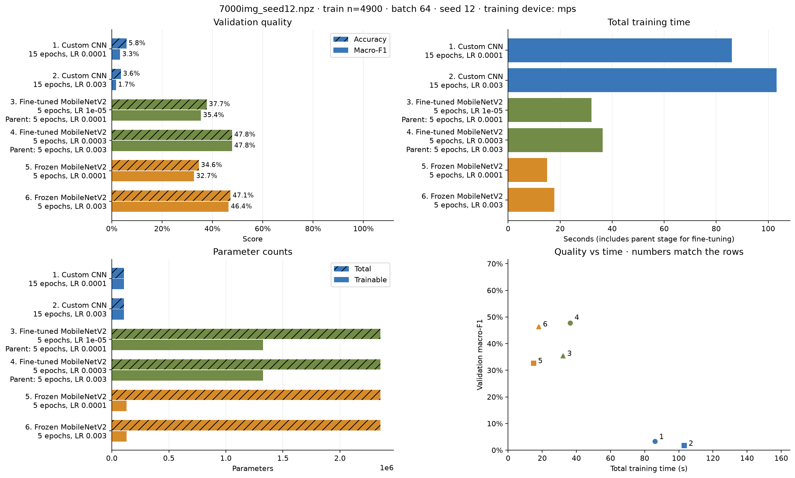

# Food Classification: CNNs and Transfer Learning

A PyTorch image-classification project comparing a small CNN trained from scratch with frozen-backbone feature extraction and partial fine-tuning of MobileNetV2 on Food-101.

The project includes an interactive command-line menu, validation-based checkpoint selection, learning curves, class-level diagnostics, and saved experiment summaries. It investigates smaller dataset subsets rather than data augmentation.

## Models

| Method | Initialization | Updated parameters | Trainable / total parameters |
|---|---|---|---:|
| Custom CNN | Random | Entire network | 106,277 / 106,277 |
| Frozen MobileNetV2 | ImageNet-1K V2 + new head | Linear classifier only | 129,381 / 2,353,253 |
| Partial fine-tuning | Best frozen-model checkpoint | Last three feature modules + head; BatchNorm fixed | 1,324,261 / 2,353,253 |

The CNN uses three `Conv2d → ReLU → MaxPool2d` blocks with 32, 64, and 128 channels, followed by global average pooling and a 101-class linear layer. MobileNetV2 uses a new `Linear(1280, 101)` classifier. Both return logits for cross-entropy loss.

Fine-tuning unfreezes `features.16`, `features.17`, and `features.18`. The backbone learning rate is one tenth of the classifier learning rate. Backbone BatchNorm parameters and running statistics stay fixed, including during fine-tuning. The head-only checkpoint is preserved.

## Saved results

The table below selects the highest validation macro-F1 **within each method** from the completed local runs on the 7,000-image subset. This subset contains **4,900 training, 1,050 validation, and 1,050 test images**, across all 101 classes. Batch size is 64 and seed is 12. All listed training times were recorded on Apple MPS.

| Method | Classifier LR | Epochs | Validation accuracy | Validation macro-F1 | Total training time |
|---|---:|---:|---:|---:|---:|
| Custom CNN | 0.0001 | 15 | 5.81% | 0.0330 | 85.97 s |
| Frozen MobileNetV2 | 0.003 | 5 | 47.14% | 0.4643 | 17.82 s |
| Partial fine-tuning | 0.0003 | 5 + 5 | 47.81% | 0.4779 | 36.36 s |

For fine-tuning, `5 + 5` means five parent head-only epochs followed by five fine-tuning epochs. The parent classifier learning rate was 0.003. Total time includes both stages; see the exact value and stage breakdown in [`metrics.csv`](results/summary/metrics.csv).

These runs favor transfer learning over this small CNN under the recorded settings. Fine-tuning improved macro-F1 slightly over the frozen model on this subset; a single seed and a small validation set do not establish a general advantage.



The [experiment summary](results/summary/README.md) describes provenance and limitations. The CSV contains 12 completed validation runs and one **previously saved** test measurement. Test rows are explicitly labeled; the table above contains validation metrics only. Exporting results does not run evaluation or training.

## Setup

Use Python 3.11 or newer. The project was checked locally with Python 3.13.9. Install a compatible PyTorch/torchvision pair for your hardware; CUDA users should follow the [official installation selector](https://pytorch.org/get-started/locally/).

```bash
python3 -m venv .venv
source .venv/bin/activate
python -m pip install --upgrade pip
python -m pip install -r requirements.txt
```

On Windows, activate with `.venv\Scripts\activate` instead. Device selection is automatic: CUDA, then Apple MPS, then CPU. Exact numerical reproducibility across devices and package versions is not guaranteed.

### Download Food-101

Download the dataset from the [original Food-101 page](https://data.vision.ee.ethz.ch/cvl/datasets_extra/food-101/) and extract it so the image directory is:

```text
data/raw/food-101/images/
    apple_pie/*.jpg
    baby_back_ribs/*.jpg
    ...
```

Food-101 contains 101,000 images in 101 categories. Images and pretrained weights are not bundled in this repository. See the original dataset page for attribution and usage terms; publishing this source code does not grant rights to the images.

### Prepare images

Run from the repository root:

```bash
python -m src.data.prepare_data
```

This writes `data/processed/food101.npz`. Every image is converted to RGB, center-cropped/resized to 160 × 160, and stored as channel-first `uint8`. Class labels follow alphabetically sorted folder names. An existing prepared archive is protected from accidental replacement; use `--overwrite` only when rebuilding it intentionally.

Optional paths:

```bash
python -m src.data.prepare_data --image-dir /path/to/food-101/images --output data/processed/food101.npz
```

The full image array alone is about **7.8 GB**. Preparation uses disk-backed temporary storage and needs space for both the temporary array and final archive, in addition to the raw dataset. Splitting/loading the full archive still requires substantial RAM and creates additional copies on disk. Start with small subsets; this implementation is intended as a straightforward coursework pipeline, not a memory-optimized full-dataset loader.

### Run experiments

```bash
python main.py
```

```text
1. Create dataset subset
2. Load dataset
3. Train model
4. Load model
5. Plot results
0. Exit
```

1. Choose **1** and enter `7000` to create the 70/15/15 subset. The number is the total subset size, not the training-image count. `700` is a smaller diagnostic setting, with only 490 training images.
2. Choose **2**, select the subset, and set the batch size.
3. Choose **3 → 1** for the CNN or **3 → 2** for frozen MobileNetV2. Enter epochs and learning rate. The first pretrained run downloads ImageNet weights through torchvision.
4. Choose **3 → 3**, then select a completed frozen-model checkpoint for partial fine-tuning. Its dataset and batch size are restored automatically. The entered learning rate is for the head; the backbone uses one tenth of it.
5. Choose **5 → 1** for validation diagnostics or **5 → 2** for model comparison. Comparisons group runs by dataset, batch size, seed, and training device.
6. Reserve **5 → 3** for final test diagnostics after configuration selection. Test metrics are not computed during training.

Existing checkpoints are not overwritten by a repeated identical run. Move the previous checkpoint elsewhere before intentionally repeating that configuration. Training is not resumable: fine-tuning starts a new optimizer from the selected parent model, and interrupted runs may lack completion metadata.

### Export existing measurements

```bash
python -m src.export_results
```

This rebuilds `results/summary/metrics.csv` from completed local checkpoints and any matching saved test diagnostics. It skips unfinished runs. The public repository includes the exported summary, not the large checkpoints needed to regenerate it.

### Run checks

```bash
python -m unittest discover -s tests -v
```

Checks use synthetic data and randomly initialized models: no dataset or pretrained-weight download is needed. They cover input/output shapes, trainable parameters, splitting, preprocessing, checkpoint round-trips, and menu validation. GitHub Actions runs the same checks on CPU.

## Experiment design

- Adam optimizer and multiclass cross-entropy.
- Best checkpoint selected by validation macro-F1, with lower validation loss breaking ties.
- Seed 12 for sampling, splits, initialization, and shuffled loading.
- Fixed ImageNet channel normalization after scaling pixels to [0,1].
- No random augmentation in the current pipeline.
- Training loss/accuracy/F1 are accumulated while weights change during the epoch; validation uses the end-of-epoch model in evaluation mode.
- Timing covers training, validation, and checkpoint work after model/optimizer construction. Downloads and model initialization are excluded. Fine-tuning totals include the parent training stage.

## Limitations

- The code pools all image folders and makes its own stratified split. **It does not use the official Food-101 train/test protocol**, so these figures are not official benchmark results. The original dataset includes noisy labels.
- Selecting a different subset size also changes validation and test images/counts. The size comparison is exploratory, not an isolated training-size intervention with a fixed holdout.
- Each subset has one seed. The 700-image setting has just 105 validation samples for 101 classes, making class-level metrics especially unstable.
- Training budgets and learning rates differ across methods. This compares complete configurations, not pretrained initialization alone. The CNN baseline has not been exhaustively tuned.
- Older diagnostic galleries include other experiments for which matching checkpoints are no longer available locally. Those files stay local and are not mixed into the public checkpoint-backed summary.
- One test result was already inspected in the project's history. No untouched-test claim or complete three-model test comparison is made.
- Inference timing has not been implemented or measured. Training speed does not imply inference speed.

## Repository structure

```text
main.py                      Interactive experiment menu
src/training.py              Models, training, evaluation, checkpoints
src/data/prepare_data.py     JPEG-to-NumPy preparation
src/data/data.py             Seeded stratified subset creation
src/data/dataset.py          Dataset, normalization, DataLoaders
src/plots.py                 Curves, confusion matrices, errors, comparisons
src/export_results.py        Export completed saved experiments
tests/                       Offline regression checks
results/summary/              Small public metrics table and provenance
results/figures/              Selected comparison charts
```

Downloaded images, prepared arrays, model checkpoints, raw histories, full diagnostic galleries, virtual environments, and IDE files are excluded from Git. They remain local when preparing the repository for publication.

## Sources and licensing

- Bossard, Guillaumin, and Van Gool, *Food-101 – Mining Discriminative Components with Random Forests*, ECCV 2014: [dataset and paper](https://data.vision.ee.ethz.ch/cvl/datasets_extra/food-101/).
- [Torchvision MobileNetV2 documentation](https://docs.pytorch.org/vision/stable/models/generated/torchvision.models.mobilenet_v2.html).
- [PyTorch transfer-learning tutorial](https://docs.pytorch.org/tutorials/beginner/transfer_learning_tutorial.html).

No open-source license has been selected for this project's source code. Dataset and pretrained-model terms are separate.
